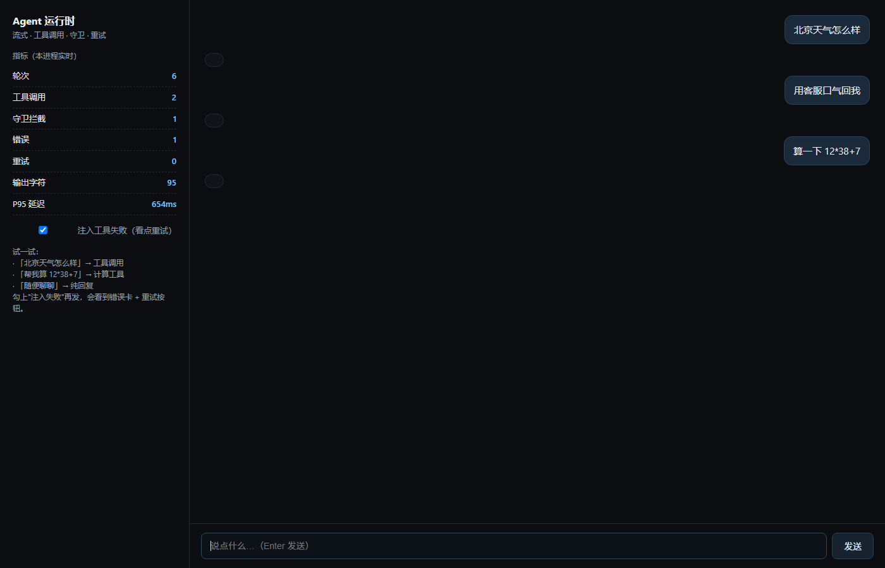

# Agent 运行时 · 三级审架构

一个能跑的 Agent 运行时：**流式输出、工具调用、输出侧守卫、失败重试、实时指标**；
背后是「人拍板 / 审计定标准 / 执行落地」的三级分工，和一套可复跑的判据。

```
node demo/server.mjs        # → http://127.0.0.1:7788
```



## 它是什么

三件事，一句话：

1. **一个能点的 Agent 产品**：发一句话，看到工具调用卡、守卫拦截、流式回复；工具坏了能重试。
2. **一套判据**：把"像不像 / 对不对 / 有没有走样"拆成可数、可 grep、可复跑的判定，而不是"看着还行"。
3. **一条可维护的分工**：谁定方案、谁判、谁执行、谁回滚，写死；改 A 不会错 B。

## 目录

```
demo/                可运行的最小产品（零依赖，Node 18+）
  server.mjs          HTTP + SSE + 工具 + 守卫 + 指标
  public/index.html   单页 UI：工具卡 / 守卫提示 / 重试 / 指标
docs/
  设计心路.md          这套东西怎么长出来的（含我判断错的地方）
  判据工程.md          主观要求 → 可观测信号 → 判据 → 豁免 → 谁判
  三级审架构.md        决策 / 审计 / 执行：职责、权限、结构性风险
bug-report/          上游产品缺陷报告（定位方法 → 结论 → 复现 → 修复 → 边界）
shots/               截图
```

## 三条命令能看到什么

```bash
# 1. 起服务
node demo/server.mjs

# 2. 打开
http://127.0.0.1:7788

# 3. 试四句（页面里也写了）
北京天气怎么样      → 工具调用卡：weather → 结果 → 流式回复
帮我算 12*38+7      → 工具调用卡：calc
用客服口气回我      → 守卫卡：命中「作为AI/我无法」→ 替换
（勾"注入工具失败"再发） → 错误卡 + 重试按钮
```

实测（SSE 原样）：

```
天气：start → tool_call(weather) → tool_result(ok) → delta×6 → done{ms:654}
守卫：guard {hits:["作为AI","我无法"],replaced:true} → delta → done
失败：tool_result{ok:false,error:"工具超时（注入）"} → delta → done
指标：{"turns":6,"toolCalls":4,"guardHits":2,"errors":2,"tokens":190,"p95":655}
```

## 结构：三级审

```
        ┌──────────────┐
        │  H 人（拍板） │  方案裁定、上线许可、一票否决
        └───┬──────┬───┘
   探讨/审查 ▼      ▲ 上报/请示
      ┌───────┐  ┌───────┐
      │ A 审查 │→ │ B 执行 │
      └───────┘  └───────┘
     出判据/选项   落地/跑测/改文件
```

- **B 执行**：粗判粗审（自检、跑测、拦明显错、出疑点清单），无终判权
- **A 审查**：主审（定判据、独立复核、签 PASS/FAIL、可否决），不碰执行
- **H 人**：终审（价值取舍、上线、一票否决）

细节见 [docs/三级审架构.md](docs/三级审架构.md)。

## 失败模式表（这套系统踩过的坑）

| 现象 | 根因 | 修法 | 现在怎么防 |
|---|---|---|---|
| 补发又重放，修两天修不好 | 补丁式修补，没有幂等 | 放弃旧桥接，先改规则再重写 | 重放先看幂等键 |
| 一条消息回五条 | 两套发送语义同时在跑 | 出口判 outbox 是否增长，已发即跳过 | 发送权单点 |
| 三会话并发后账本只剩一行 | 读—改—写整文件覆盖 | 改追加写 | 判据：三行都在 |
| 一句工单把会话拖死，后面全超时 | 把非对话句当活干 | 空回复单列，不与人设违规混算 | 语料先筛 |
| 长上下文后"助手腔"抬头 | 只靠主观判断 | 12 条禁语清单，命中即 FAIL | 机判否决项，不判总分 |
| 判据假红（"我不接这一句"被判违规） | 没有否定窗口 | 命中词前 8 字含否定词则不算 | 每条判据先写豁免 |
| 写死后遇到没写过的场景就退化 | 规则只覆盖写过的世界 | 只给要求/判据/底线 | 新场景补判据，不补台词 |

## 判据：怎么证明它有用

```
同一批 6 条样本，四种口径跑：
  A 无豁免        4/6   ← 两条假阳性
  B 有豁免        5/6   ← 只剩真违规
  C 判据改坏      3/6   ← 把称呼判据换成另一个词，合规也红
  D 改回判据      5/6   ← 回绿
证明的不是"能判过"，是"改坏了立刻红、改回来立刻绿"。
```

详见 [docs/判据工程.md](docs/判据工程.md)。

## 上游缺陷报告

`bug-report/` 是一份对真实产品的缺陷报告：**先讲怎么定位，再讲定位到什么**。

```
20 个观察点 ｜ 15 条 ≥3 次独立复现 ｜ 2 条本地修复并反证 ｜ 用时 4 小时
```

入口：[bug-report/00-README.md](bug-report/00-README.md)

## 边界（说清楚哪里不完整）

```
· demo 的模型是本地规则，不接真 LLM（接口形状与真模型一致，避免 key 与费用）
· 会话只存内存，重启即清；无鉴权、无多租户（单机 demo）
· 重试是重发同一轮，不做指数退避
· 上游报告只覆盖单账号、免费档位；未达 3 次的条目在报告里明写，不凑数
```

## 关于这份工作：AI 参与说明

这份东西是我和 AI 助手一起做出来的，写在这里，免得误会：

```
我（人）
  定方向、做取舍、判价值、拍板、一票否决；验收标准由我确认。
执行（AI 助手）
  写代码、跑测试、整理文档、压测、抓 bug；按我的要求落地，不能自判"通过"。
审查（另一个 AI 角色）
  出判据、复核结果、可否决；不碰执行，只读产物。
```

所以：

- **判断、取舍、上线与否，是人做的**；错了也由人认。
- **执行层面的产出（代码、报告、文档）主要由 AI 助手完成**，我负责给要求、验收、返工。
- 这份工作本身也是"如何用 AI 干活"的一个样本：分工、判据、证据链、回滚，都是为了让 AI 的产出可控。

不藏这一点，是因为我认为：**会用 AI 把活干成，本身就是这个岗位要的能力。**

## License

MIT
